# Lumina

**Answer once. She can ask forever.**

<p>
  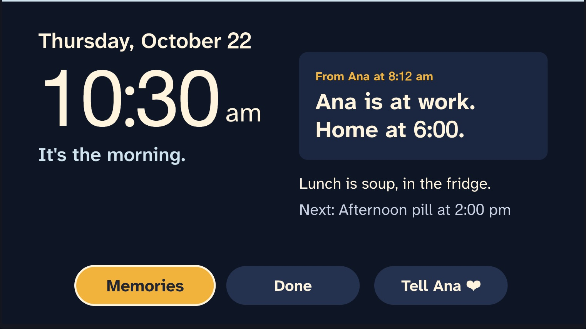
  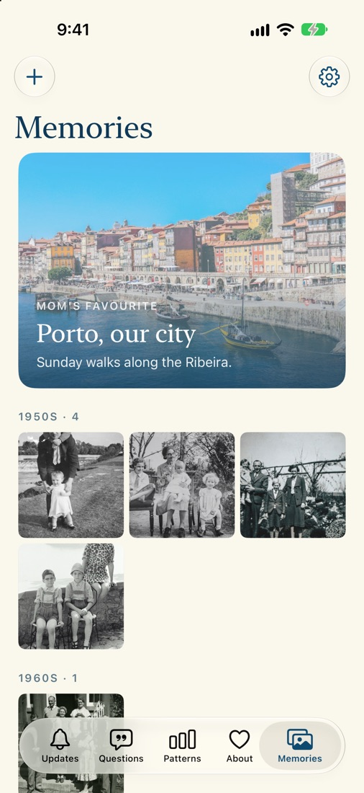
  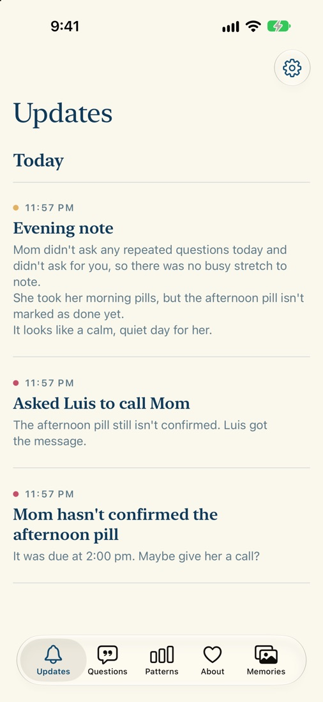
</p>

## Why we built it
Rosa is 76 and has early Alzheimer's. Her daughter Ana is 29 and works all day. Rosa asks "Where's Ana?" twenty times before lunch.
Each time it feels new to her, and each time Ana's phone rings at work. Ana loves her mother and is worn out.

This happens in millions of homes. About 7.4 million Americans over 65 live with Alzheimer's, and more than 12 million family members
care for them without pay ([Alzheimer's Association, 2026](https://www.alz.org/alzheimers-dementia/facts-figures)).
Worldwide, more than 55 million people live with dementia, with nearly 10 million new cases a year ([WHO](https://www.who.int/news-room/fact-sheets/detail/dementia)).

## The problem
Repeated questions are what families notice most. In 1,707 dementia profiles, 47% of caregivers picked verbal repetition as a symptom to track,
and 90.5% of that was repeated questions ([Reeve 2017](https://pmc.ncbi.nlm.nih.gov/articles/PMC5426314/)).
They come from failing to hold new information ([Cullen 2005](https://eprints.gla.ac.uk/62494)), so arguing or distracting doesn't help.
A better answer does: one that is calm, the same every time, and in front of her.

## What the research says, and what we took from it
| Finding | What Lumina does |
|---|---|
| Written cues cut repeated questions, and the effect lasted 16+ weeks ([Bourgeois 1997](https://gerontologist.gerontologyjournals.org/cgi/content/abstract/37/1/30)) | Ana's answer stays on the TV as a big written line, not only spoken once |
| Behaviour in dementia is handled by Describe, Investigate, Create, Evaluate ([Kales, Gitlin & Lyketsos 2015](https://pmc.ncbi.nlm.nih.gov/articles/PMC4707529)) | The agent notices, checks for an unmet need, takes one step from Ana's playbook, then checks whether it helped |
| Agitation peaks differ by person; only 2.4% fit the "sundowner" label ([Martin 2000](https://pubmed.ncbi.nlm.nih.gov/10841213/)) | Rosa is compared only with her own last 14 days, per hour |
| Tailored activities beat generic ones ([Gitlin 2008](https://pmc.ncbi.nlm.nih.gov/articles/PMC2803044)) | The playbook is Ana's, and she can turn any step off |
| Alerts alone didn't reduce caregiver burden ([Gaugler 2021](https://doi.org/10.1186/s12877-021-02634-8)) | Few alerts, each with one clear action; Ana rates every step |
| Reminiscence with family photos helps mood a little, inconsistently ([Woods 2018, Cochrane](https://discovery.ucl.ac.uk/id/eprint/10045364/)) | Photos are for connection, not sold as treatment |

## How Lumina helps
- **Ana answers once**, in her own words, from her phone. Lumina checks the answer is short and kind, and Ana approves it.
- **Rosa's TV** shows the time, the part of the day and Ana's answer, in big letters. Between questions it plays the family album.
- **Alexa** gives the same answer every time Rosa asks, however she asks it: "Where's my girl?", "Is Ana home?", "Where did Ana go?".
- **The family** sends photos from a link, no app needed. Ana approves each one, and it appears on Rosa's TV right away.
- **The agent** watches Rosa's rhythm. When her questions rise above her own normal, it takes one small step and tells Ana why.

Rosa only ever hears words Ana approved. If Lumina doesn't know, it says "I'm not sure, Rosa. I'll let Ana know."

## A day with Lumina
| Time | What happens |
|---|---|
| 8:05 | Ana leaves for work. She updates one answer on her phone: "At work. Home at six." |
| 10:00 | The TV plays Rosa's album: her father by the river, her wedding in Braga, Porto in the eighties. |
| 11:20 | Rosa: "Alexa, ask my Lumina where's Ana." Alexa: "Ana is at work, Rosa. She's home at six o'clock." |
| 14:00 | The TV shows the afternoon pill. Rosa presses Done. If she doesn't, Ana hears about it at 14:30 and her brother Luis at 14:45. |
| 16:10 | Questions rise, as they usually do. Lumina shows Ana's answer larger on the TV and checks an hour later if it helped. |
| 17:30 | A cousin sends a Christmas photo from the share link. Ana approves it on the bus; it's on Rosa's TV seconds later. |
| 20:00 | Ana gets a short evening note: how the day went, what helped, what still needs an answer. |

## Screenshots
**Setting up** (about 3 minutes)

<p>
  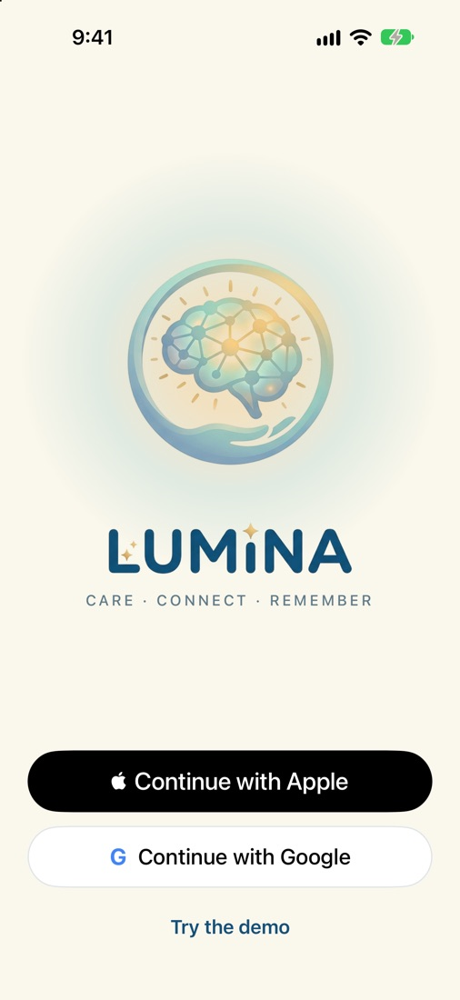
  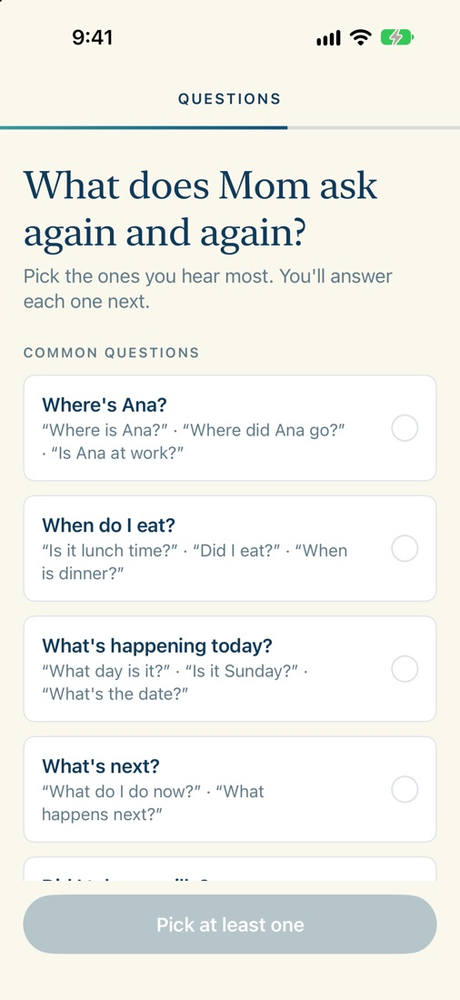
  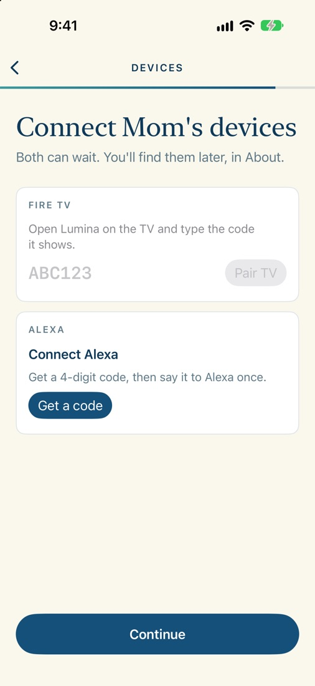
</p>

**Ana's app**

<p>
  
  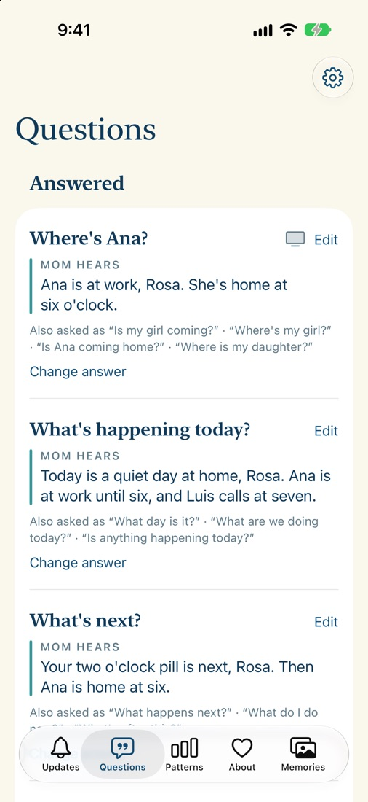
  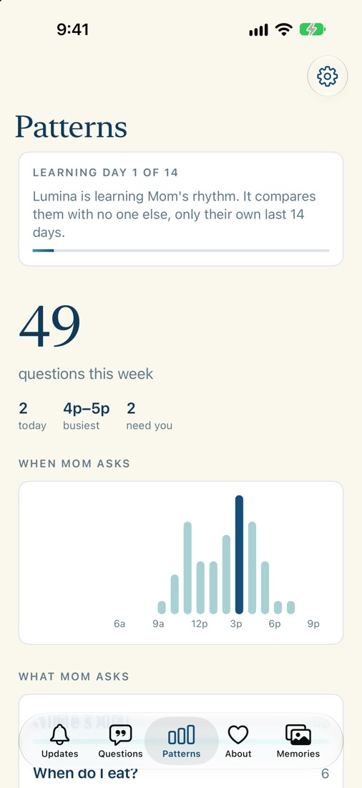
  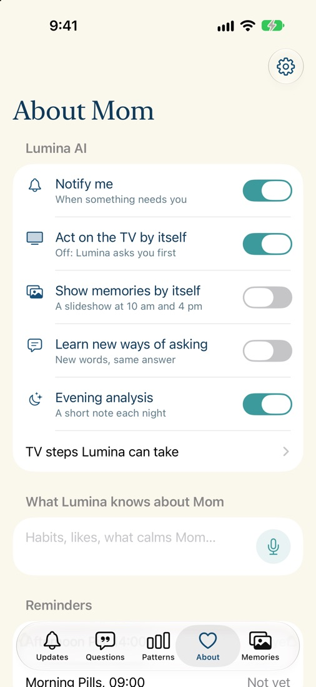
  
</p>

**Rosa's TV**

<p>
  
  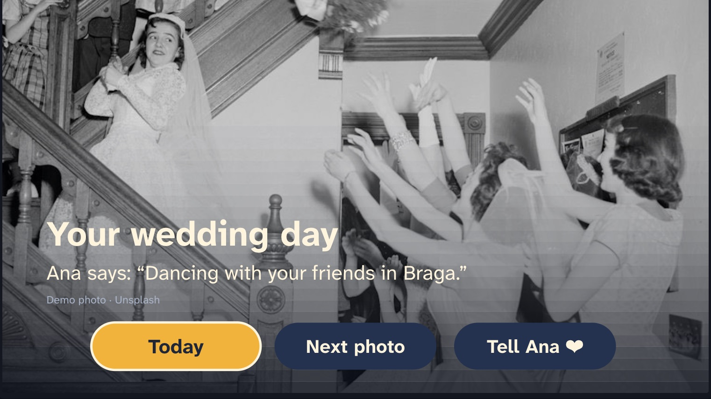
</p>

## Technology

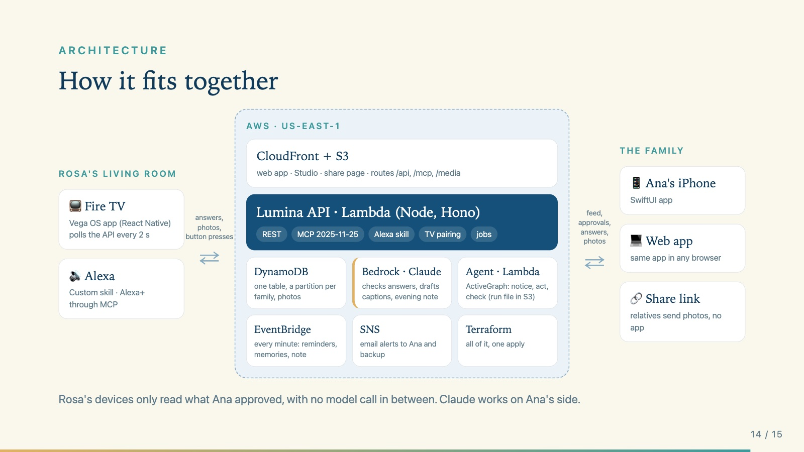

| | |
|---|---|
| Fire TV | React Native app for **Vega OS** (`tv/vega`) and Fire OS (`tv/android`), sharing one set of screens (`tv/shared`). Built for 10-foot viewing: big text, three buttons, slow changes. Pairs with the phone by a 6-letter code. |
| Alexa | A custom **Alexa skill** (`alexa/`, endpoint `/alexa`) and an **MCP server** (spec 2025-11-25, Streamable HTTP, `/mcp`) for Alexa+ and other assistants. Both only read what Ana approved. |
| AI | **Claude on Amazon Bedrock**, on Ana's side only: it checks her answers, drafts photo captions and stories, writes the evening note and picks the agent's next step. The agent runs on **ActiveGraph**, so every step has a reason Ana can read. |
| Phone | SwiftUI iPhone app (`ios/`) and the same app on the web (`/app`) for families without an iPhone. |
| Cloud | **AWS Lambda** (Hono), **DynamoDB** (one table, one partition per family), **EventBridge** every minute, **SNS** email alerts, **S3 + CloudFront** for the web. Terraform in `infra/`. |

## Try it
- Caregiver web app: https://d34mg9c3oavp9o.cloudfront.net/app ("Try the demo", no sign-in)
- Studio (TV, Alexa and phone side by side): https://d34mg9c3oavp9o.cloudfront.net
- Alexa skill endpoint: `https://i6fya4jsl7snqhu6z6qkffmr7q0ubogx.lambda-url.us-east-1.on.aws/alexa`

## Run it
```bash
docker compose up --build                 # http://localhost:8787, offline fallbacks, no AWS needed
eval "$(aws configure export-credentials --format env)" && LLM=bedrock docker compose up
```

**Rosa's TV.** Both TV apps read `config.ts` (`API_URL`, `TOKEN`), written by the launch scripts from `LUMINA_TV_API` and `LUMINA_TV_TOKEN`.
With no token the TV shows a code; enter it in the iPhone app (setup, or About → TV and Alexa).
```bash
LUMINA_TV_API=https://i6fya4jsl7snqhu6z6qkffmr7q0ubogx.lambda-url.us-east-1.on.aws bash scripts/windows/vega-ubuntu.sh   # Vega Virtual Device (Ubuntu / WSL2)
scripts/firetv-emulator.sh                                                                                            # Fire OS emulator (macOS)
```

**Alexa skill.** developer.amazon.com/alexa → Create skill → Custom → Provision your own. Paste
`alexa/skill-package/interactionModels/custom/en-US.json` into the JSON Editor, Save, Build. Endpoint: HTTPS, `<api>/alexa`,
"sub-domain of a domain that has a wildcard certificate". Then: "ask my lumina where's Ana". About → TV and Alexa → Connect Alexa links it to a person.

**iPhone app.** `open ios/Lumina.xcodeproj` and Run. Google sign-in needs `GoogleClientID` in `Info.plist` and `GOOGLE_CLIENT_ID` on the server.

**Deploy.**
```bash
npm run build -w web && npm run build -w api
cd infra && terraform apply               # deploy_cloud = true in terraform.tfvars
aws s3 sync ../web/dist "s3://$(terraform output -raw web_bucket)" --delete
```

## What Lumina doesn't do
It doesn't diagnose, treat or predict anything. It never stores audio. Nothing reaches Rosa that Ana hasn't approved.
The demo photos are from Unsplash and labelled as demo photos.
